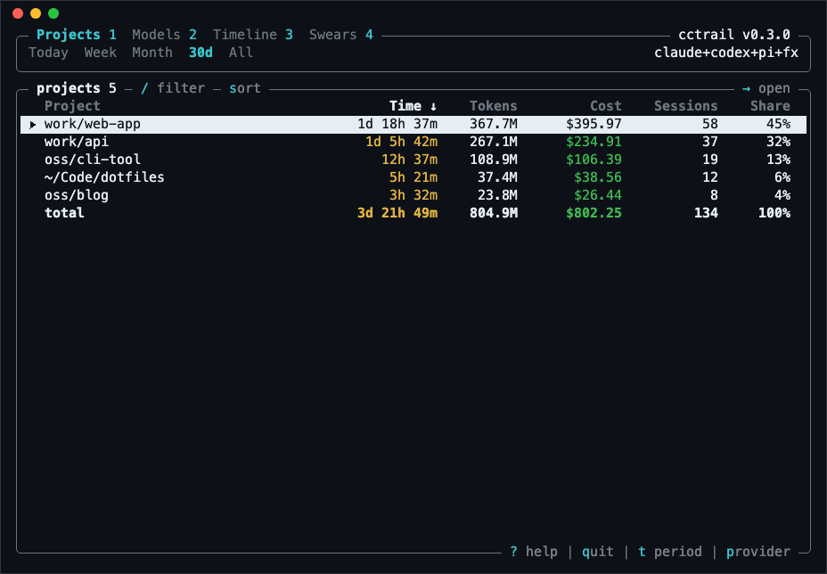
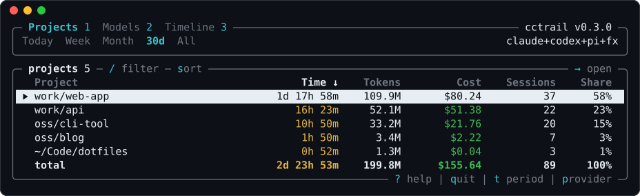

cctrail reads the local history of Claude Code, Codex, [pi](https://pi.dev) and [fx](https://fx.sh) and shows, for each project, how much time you spent in it, how many tokens it used and what that would cost at API prices. It needs no setup: repositories are found from the sessions themselves, with agent worktrees and clones counted as one project.

It's for people who work with coding agents across several projects and want real numbers. Time is active time: idle gaps don't count and parallel projects split it. Cost uses each request's API price of its day, so you can compare it with your subscription. History copied into subagents, forks or another profile counts once.

Run it without arguments for an interactive view of projects, models and a timeline. There's also a Swears tab that shows how often you scold each model. Text and JSON reports cover scripts.



## Install

Download the archive for macOS (Apple Silicon), Linux or Windows from the [latest release](https://github.com/vladkens/cctrail/releases/latest) and put `cctrail` into a folder on your `PATH`. Or build it with Rust:

```sh
cargo install cctrail
```

```sh
cctrail
cctrail this-month
cctrail --json
```
