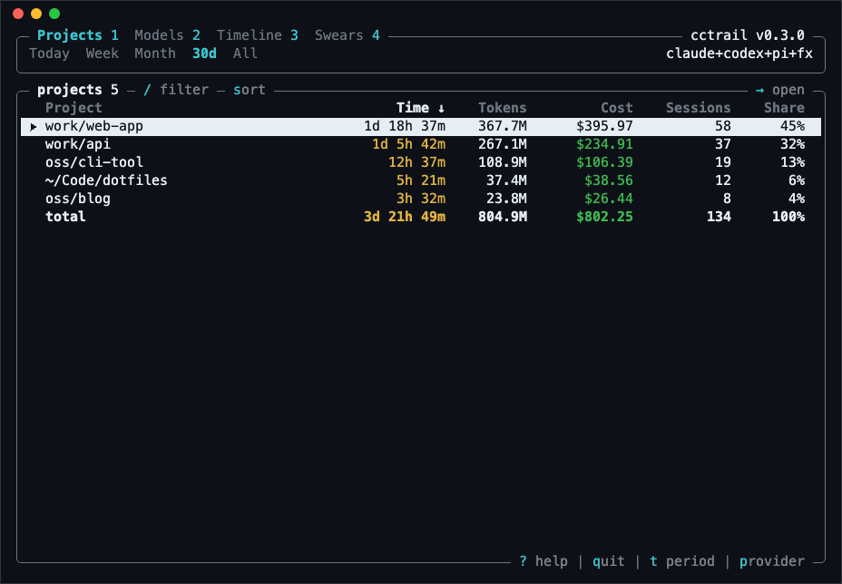
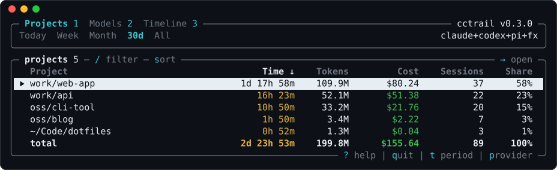

cctrail читает локальную историю Claude Code, Codex, [pi](https://pi.dev) и [fx](https://fx.sh) и показывает по каждому проекту, сколько времени ты в нём провёл, сколько токенов ушло и сколько это стоило бы по ценам API. Настраивать ничего не нужно: репозитории находятся из самих сессий, а worktrees агентов и клоны считаются одним проектом.

Он для тех, кто работает с coding-агентами в нескольких проектах и хочет видеть реальные цифры. Время считается активное: простои не идут в зачёт, а параллельные проекты делят его между собой. Стоимость считается по цене API на день каждого запроса, так что её можно сравнить с подпиской. История, скопированная в subagents, форки или другой профиль, считается один раз.

Без аргументов открывается интерактивный режим с проектами, моделями и таймлайном. Есть и вкладка Swears: она показывает, как часто ты ругаешь каждую модель. Для скриптов есть текстовые отчёты и JSON.



## Установка

Скачай архив для macOS (Apple Silicon), Linux или Windows из [последнего релиза](https://github.com/vladkens/cctrail/releases/latest) и положи `cctrail` в папку из `PATH`. Или собери через Rust:

```sh
cargo install cctrail
```

```sh
cctrail
cctrail this-month
cctrail --json
```
