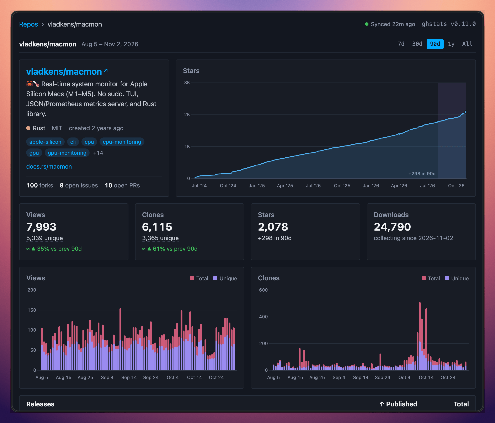

GitHub only keeps repository traffic data for 14 days. ghstats pulls that data from the GitHub API every hour and keeps your own history of views, clones, stars, forks, issues and pull requests in a local SQLite database, so it stays for months or years instead of disappearing after two weeks.

It's for personal projects, open-source portfolios, organization dashboards and public stats pages. Each repository gets a dashboard with stars, clones, views, referrers and popular paths. You choose which repos to collect and show, and you can read the data through a JSON API or embed it as SVG badges. The GitHub numbers in my [2024 review](/2024-in-review/) came from it.

I wanted the setup to stay boring: one Rust binary, one SQLite database, one Docker image. No Postgres, no hosted account, and the web UI loads nothing from a CDN.

## Install

ghstats needs a GitHub token. Create a classic token with the `public_repo` scope at https://github.com/settings/tokens and save it to `.env` as `GITHUB_TOKEN=ghp_XXX`. Then:

```sh
docker run -d --env-file .env -p 8080:8080 -v ./data:/app/data --name ghstats ghcr.io/vladkens/ghstats:latest
```

Open http://127.0.0.1:8080 after the container starts.
