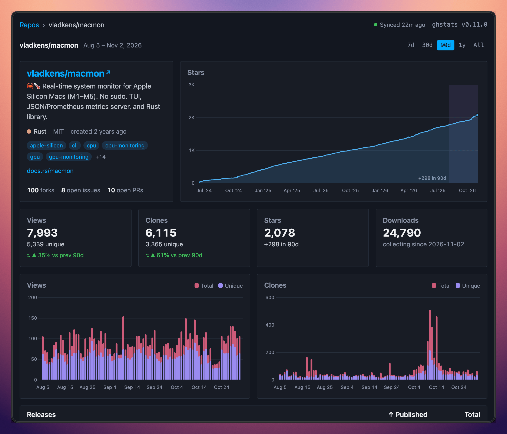

GitHub хранит данные о трафике репозитория всего 14 дней. ghstats каждый час забирает их через GitHub API и копит историю просмотров, клонов, звёзд, форков, issues и pull requests в локальной базе SQLite, так что данные остаются на месяцы и годы, а не пропадают через две недели.

Подойдёт для личных проектов, open-source портфолио, дашбордов организации и публичных страниц со статистикой. У каждого репозитория свой дашборд со звёздами, клонами, просмотрами, referrers и популярными путями. Какие репозитории собирать и показывать, выбираешь сам, а данные можно забирать через JSON API или встраивать как SVG-бейджи. Цифры по GitHub в моём [обзоре за 2024 год](/2024-in-review/) взяты отсюда.

Хотелось, чтобы всё было скучно и просто: один бинарник на Rust, одна база SQLite, один Docker-образ. Без Postgres и аккаунта в чужом сервисе, а web UI ничего не грузит с CDN.

## Установка

ghstats нужен GitHub-токен. Создай classic token со scope `public_repo` на https://github.com/settings/tokens и сохрани его в `.env` как `GITHUB_TOKEN=ghp_XXX`. Затем:

```sh
docker run -d --env-file .env -p 8080:8080 -v ./data:/app/data --name ghstats ghcr.io/vladkens/ghstats:latest
```

Когда контейнер запустится, открой http://127.0.0.1:8080.
