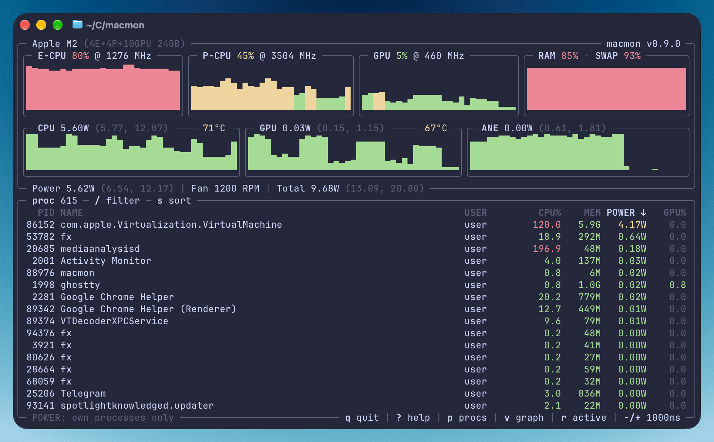

macmon shows what an Apple Silicon Mac is doing right now: CPU, GPU and ANE power, temperatures, RAM, swap and memory pressure, with charts and a process list that has CPU, memory, power and GPU usage per process. It runs in the terminal, follows your color scheme and fits in a small window.

It's for anyone who wants to look inside their Mac without typing a password, and for people who want those numbers somewhere else. `macmon pipe` prints JSON for scripts, `macmon serve` exposes JSON and Prometheus metrics over HTTP for Grafana, and the Rust library gives you the same data in your own app. [exo](https://github.com/exo-explore/exo) can use it for GPU usage, power and temperature monitoring on Apple Silicon.

When Macs moved to ARM, old system APIs stopped working and existing monitoring tools with them. macOS has `powermetrics`, but it prints plain text and needs `sudo`, and so does `asitop`, which is built on top of it. macmon reads the same data through a private macOS API, without root. It was my first public Rust project and took a lot of [reverse engineering of powermetrics](/powermetrics-macos/).

A private API has a price. macOS 27 broke the source macmon used for CPU and ANE power, so it now reads hidden energy reports from the AppleCLPC driver instead. New chips or driver versions may need additional mappings.

## Install

```sh
brew install macmon
```

Also available through MacPorts, Cargo and Nix:

```sh
sudo port install macmon
cargo install macmon
nix-env -i macmon
```

Run `macmon` to open the terminal UI and press `?` to see the keys.

```sh
macmon pipe | jq
macmon serve
```
