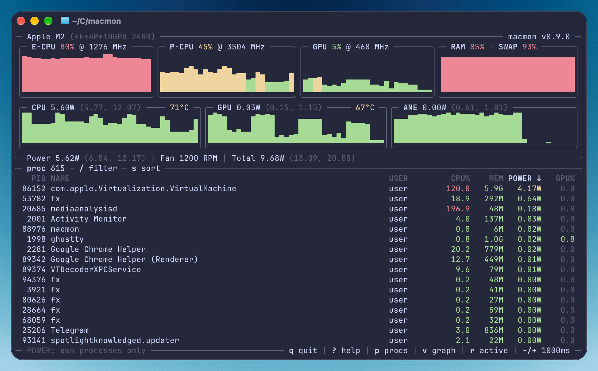

macmon показывает, чем прямо сейчас занят Mac на Apple Silicon: мощность CPU, GPU и ANE, температуры, RAM, swap и memory pressure, плюс графики и список процессов с CPU, памятью, мощностью и GPU по каждому. Работает в терминале, подхватывает его цветовую схему и влезает в маленькое окно.

Он для тех, кто хочет заглянуть внутрь своего Mac, не вводя пароль, и для тех, кому эти цифры нужны где-то ещё. `macmon pipe` выводит JSON для скриптов, `macmon serve` отдаёт JSON и метрики Prometheus по HTTP для Grafana, а Rust-библиотека даёт те же данные в твоём приложении. [exo](https://github.com/exo-explore/exo) может использовать его для мониторинга GPU, мощности и температуры на Apple Silicon.

Когда Mac перешли на ARM, старые системные API перестали работать, а вместе с ними и существующие утилиты мониторинга. В macOS есть `powermetrics`, но он выводит обычный текст и требует `sudo`, как и `asitop`, который работает поверх него. macmon читает те же данные через приватный API macOS, без root. Это был мой первый публичный проект на Rust, и в нём было много [реверс-инжиниринга powermetrics](/powermetrics-macos/).

У приватного API есть цена. macOS 27 сломала источник, из которого macmon брал мощность CPU и ANE, так что теперь он читает скрытые energy reports драйвера AppleCLPC. Новым чипам и версиям драйвера могут понадобиться дополнительные маппинги.

## Установка

```sh
brew install macmon
```

Есть также в MacPorts, Cargo и Nix:

```sh
sudo port install macmon
cargo install macmon
nix-env -i macmon
```

Запусти `macmon`, чтобы открыть терминальный интерфейс, а клавиши покажет `?`.

```sh
macmon pipe | jq
macmon serve
```
