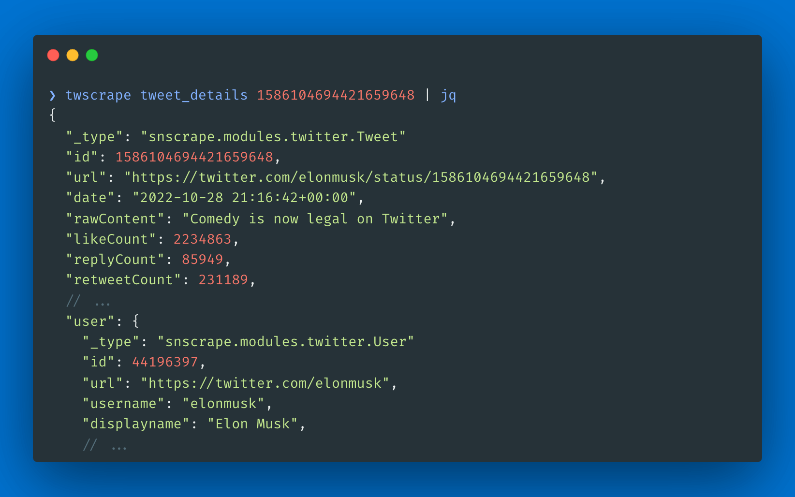

twscrape gets data from X/Twitter through its Search and GraphQL endpoints: tweets, replies, users, followers, lists, communities and trends. It's async, so several scrapers can run at once, and it returns parsed SNScrape-style models or raw API responses. The CLI prints JSON Lines.

It runs on your own accounts. Sessions are kept in SQLite, and rate limits are tracked per account and per endpoint: when an account is limited for one operation, twscrape locks it until the reset time and tries another active one. Each account can have its own proxy.

It's for people who need X data for analysis. In February 2023 Twitter set unrealistic prices for its API. Libraries like snscrape kept working through the web's public APIs until April 2023, when search became available to authorized accounts only. I released twscrape in May 2023 to keep collecting data with authorized accounts. X keeps adding new obstacles, so the project needs regular work.

X's Terms of Service discourage using multiple accounts, so use it responsibly and at your own discretion. twscrape collects anonymous telemetry about used GraphQL operation names and the HTTP backend. It doesn't collect usernames, cookies, proxies, queries, request URLs or response bodies, and `TWS_TELEMETRY=0` turns it off.

## Install

```sh
pip install twscrape
```

twscrape needs authorized accounts. The most stable setup is to add one from browser cookies, which [unjar](/apps/unjar/) exports from your current browser profile:

```sh
unjar x.com -f header | twscrape add_cookie my_account
twscrape accounts
twscrape search "from:xdevelopers lang:en" --limit=20
```
