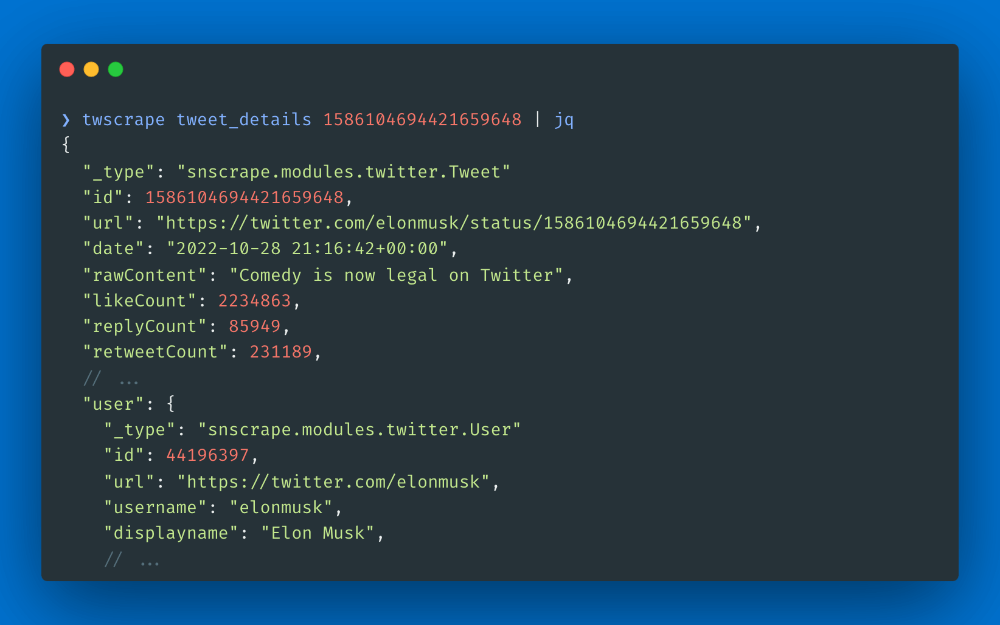

twscrape достаёт данные из X/Twitter через Search и GraphQL endpoints: твиты, ответы, пользователей, подписчиков, списки, сообщества и тренды. Он асинхронный, поэтому можно запускать несколько скраперов сразу, и отдаёт либо модели в стиле SNScrape, либо сырые ответы API. CLI пишет JSON Lines.

Работает на твоих аккаунтах. Сессии хранятся в SQLite, а rate limits считаются по каждому аккаунту и endpoint: если аккаунт упёрся в лимит на какой-то операции, twscrape блокирует его до сброса и пробует другой активный. Каждому аккаунту можно задать свой прокси.

Он для тех, кому нужны данные из X для аналитики. В феврале 2023 Twitter выставил за API нереальные цены. Библиотеки вроде snscrape продолжали работать через публичные web API, но в апреле 2023 поиск закрыли для всех, кроме авторизованных аккаунтов. В мае 2023 я выпустил twscrape, чтобы и дальше собирать данные через авторизованные аккаунты. X постоянно вставляет новые палки в колёса, так что проект требует регулярной работы.

Условия использования X не поощряют несколько аккаунтов, так что используй ответственно и на своё усмотрение. twscrape собирает анонимную телеметрию о названиях GraphQL-операций и HTTP-бэкенде. Логины, cookies, прокси, запросы, URL и тела ответов он не собирает, а отключается всё через `TWS_TELEMETRY=0`.

## Установка

```sh
pip install twscrape
```

Для работы нужны авторизованные аккаунты. Самый стабильный вариант — добавить аккаунт из cookies браузера, их экспортирует из текущего профиля [unjar](/apps/unjar/):

```sh
unjar x.com -f header | twscrape add_cookie my_account
twscrape accounts
twscrape search "from:xdevelopers lang:en" --limit=20
```
