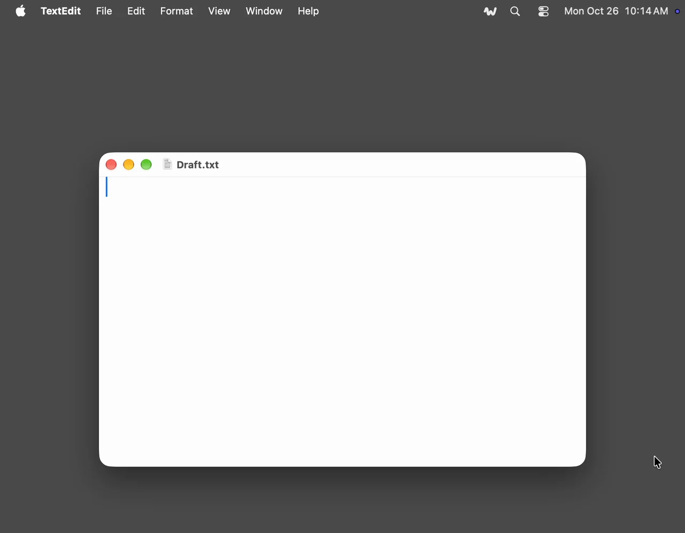

Wavo turns speech into text on your own computer, on the GPU or a Mac's Neural Engine. There's no account and no subscription, and your voice never leaves the machine. It comes as a desktop app for dictation and as a command-line tool and Rust library for recordings. The app is built on the library.

## The app

Hold a hotkey, speak, let go, and the text lands where you were typing: a chat, an editor, a terminal, any app. Wavo lives in the menu bar or the tray and works on macOS, Windows and Linux, on X11 and Wayland. It keeps every dictation with its recording, so you can search the history, play it back, transcribe it again or export it.

Parakeet Ultra is the default model and covers 25 European languages; Whisper covers the rest, for 100 in total. If you speak one or two languages, smaller models can be faster and as accurate. I dictate with Parakeet v2 for English and GigaAM v3 for Russian, and switch between them in the menu.

## The CLI and library

`wavo` is for audio files. Give it a voice note or a two-hour meeting and get the text with timestamps, as plain text, JSON or SRT subtitles. Long recordings are split at pauses and joined back. On an M2, an hour of audio takes under a minute with Parakeet or GigaAM.

Models are managed like in ollama: `pull`, `list`, `rm`. `wavo serve` answers OpenAI's transcription API, so apps and scripts written for `whisper-1` transcribe locally instead. The library is pure Rust and builds with a plain `cargo build`: no CMake, C++ toolchain, Python or ONNX Runtime to install.

## Why

Wavo is inspired by [Handy](https://github.com/cjpais/Handy) and runs the same models. I built it for the technology: with agents around, there's no reason to put up with apps that aren't native and waste memory and compute. Handy is a webview app. Wavo draws a native UI on each OS with [nimbo](https://github.com/vladkens/nimbo) and runs its own engine in pure Rust. On a Mac with macOS 15 or later, 11 s of speech becomes text in 61 ms on an M2's Neural Engine.

It also adds what I missed in Handy: an automatic microphone choice, and a history that can be exported with its recordings.

## Install the app

Download the file for your system from the [latest release](https://github.com/vladkens/wavo-app/releases/latest) and run it. There are builds for macOS 14.2 or later on Apple Silicon, Windows 10 or 11, and Linux as an AppImage or a `.deb`. The Windows build isn't signed yet, so SmartScreen will warn you: More info → Run anyway.

```sh
sudo apt install ./Wavo-<version>-linux-x86_64.deb
```

Pick a model in Settings › Models. Parakeet Ultra is about 0.7 GB, downloaded once. Then hold Option-Space (Ctrl+Alt+Space on Windows and Linux), speak and let go.

## Install the CLI

Download the binary for macOS (Apple Silicon), Linux or Windows from the [latest release](https://github.com/vladkens/wavo/releases/latest) and put it into a folder on your `PATH`. Or build it with Rust, which takes a few minutes:

```sh
cargo install wavo
```

```sh
wavo talk.m4a
wavo run gigaam-v3 talk.mp3
wavo run talk.wav --srt > talk.srt
wavo serve
```

To use it as a library:

```sh
cargo add wavo --no-default-features --features hub
```
