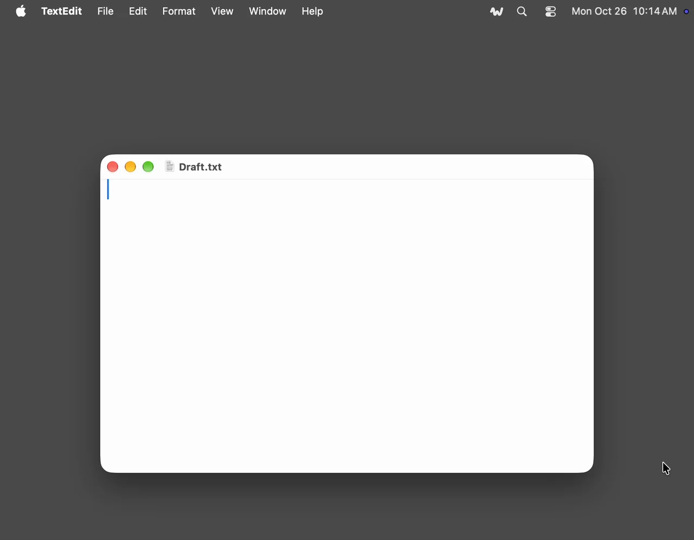

Wavo переводит речь в текст прямо на твоём компьютере, на GPU или на Neural Engine в Mac. Ни аккаунта, ни подписки, и голос никуда с машины не уходит. Есть десктопное приложение для диктовки, а для записей — консольная утилита и Rust-библиотека. Приложение построено на этой библиотеке.

## Приложение

Зажимаешь hotkey, говоришь, отпускаешь — и текст появляется там, где ты печатал: в чате, редакторе, терминале, любой программе. Wavo живёт в menu bar или в трее и работает на macOS, Windows и Linux, на X11 и Wayland. Каждая диктовка сохраняется вместе с записью: историю можно искать, переслушивать, распознавать заново и экспортировать.

Модель по умолчанию — Parakeet Ultra, она покрывает 25 европейских языков; остальные берёт на себя Whisper, всего выходит 100. Если говоришь на одном-двух языках, модели поменьше могут работать быстрее и не хуже по точности. Сам диктую на Parakeet v2 по-английски и на GigaAM v3 по-русски и переключаюсь между ними в меню.

## CLI и библиотека

`wavo` нужен для аудиофайлов. Даёшь ему голосовое или двухчасовую встречу, получаешь текст с таймкодами: обычным текстом, в JSON или субтитрами SRT. Длинные записи режутся по паузам и склеиваются обратно. На M2 час аудио обрабатывается меньше чем за минуту с Parakeet или GigaAM.

Модели управляются как в ollama: `pull`, `list`, `rm`. `wavo serve` отвечает по transcription API от OpenAI, так что приложения и скрипты, написанные под `whisper-1`, начинают распознавать локально. Библиотека на чистом Rust и собирается обычным `cargo build`: CMake, C++ toolchain, Python и ONNX Runtime ставить не нужно.

## Зачем

Wavo вдохновлён [Handy](https://github.com/cjpais/Handy) и использует те же модели. Делал его ради технологии: сейчас, когда есть агенты, незачем мириться с не-нативными приложениями, которые впустую тратят память и ресурсы. Handy — это webview-приложение. Wavo рисует нативный UI на каждой ОС через [nimbo](https://github.com/vladkens/nimbo) и работает на собственном движке на чистом Rust. На macOS 15 и новее 11 секунд речи превращаются в текст за 61 мс на Neural Engine в M2.

А ещё тут есть то, чего мне не хватало в Handy: автоматический выбор микрофона и история, которую можно экспортировать вместе с записями.

## Установка приложения

Скачай файл для своей системы из [последнего релиза](https://github.com/vladkens/wavo-app/releases/latest) и запусти. Есть сборки для macOS 14.2 и новее на Apple Silicon, Windows 10 и 11, а для Linux — AppImage и `.deb`. Сборка для Windows пока не подписана, поэтому SmartScreen предупредит: More info → Run anyway.

```sh
sudo apt install ./Wavo-<version>-linux-x86_64.deb
```

Выбери модель в Settings › Models. Parakeet Ultra весит около 0.7 GB и скачивается один раз. Дальше зажимаешь Option-Space (Ctrl+Alt+Space на Windows и Linux), говоришь и отпускаешь.

## Установка CLI

Скачай бинарник для macOS (Apple Silicon), Linux или Windows из [последнего релиза](https://github.com/vladkens/wavo/releases/latest) и положи в папку из `PATH`. Или собери через Rust, это займёт несколько минут:

```sh
cargo install wavo
```

```sh
wavo talk.m4a
wavo run gigaam-v3 talk.mp3
wavo run talk.wav --srt > talk.srt
wavo serve
```

Чтобы использовать как библиотеку:

```sh
cargo add wavo --no-default-features --features hub
```
