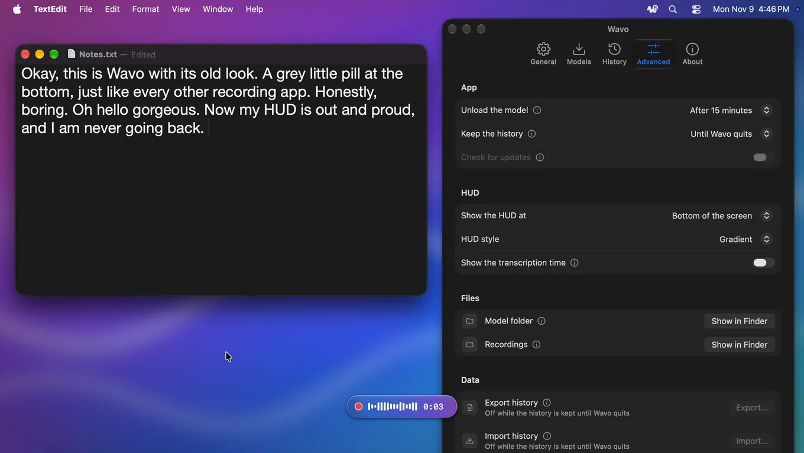
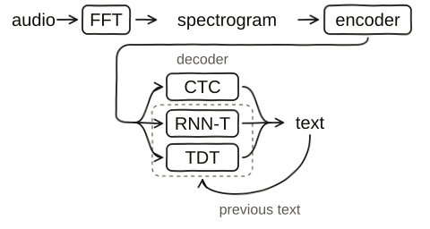
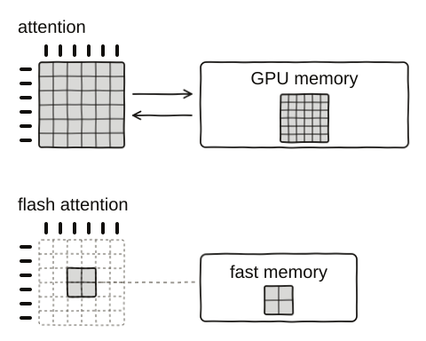

I swapped my M2 MacBook with the old design for a new fanless M5 Air. A new computer feels like a clean start. So instead of dragging all my old apps and settings along, I went looking for lighter and more native alternatives. For example, I replaced VS Code with [Zed](https://github.com/zed-industries/zed) and Chrome with [Helium](https://github.com/imputnet/helium).

To talk to agents, I used a dictation app called [Handy](https://github.com/cjpais/Handy). But I really didn't like that it's built on [Tauri](https://github.com/tauri-apps/tauri), and I wanted something native. I asked an agent to find an alternative, but nothing it found worked for me. So I decided to write my own.

People on X are rewriting everything in [GPUI Kit](https://github.com/longbridge/gpui-kit) right now, so I decided to try it too. The author of Handy had also moved the speech recognition engine into a separate project called [transcribe.cpp](https://github.com/handy-computer/transcribe.cpp). So the task looked easy, especially with agents.

## Week 1. Picking a GUI and prototypes

So I took GPUI Kit, the one everyone on X was hyping, and quickly built the first version of the UI with agents. It came out pretty well: the app with an open window used about 80 MB of RAM. But compiling was painfully slow. Part of it was GPUI Kit itself, and part was linking transcribe.cpp, which took about a minute on every rebuild.

I also didn't like that GPUI Kit pulls in over 400 dependencies, just like Node.js. Who knows what malware might be hiding in there? Besides, [GPUI](https://github.com/zed-industries/zed/tree/main/crates/gpui) from Zed isn't a finished library with stable releases. So GPUI Kit depends on a dev version from the Zed repo, and the API can change at any moment. Another problem is integration with the system, like a tray icon or a native context menu. GPUI Kit doesn't have it, so all of that has to be written by hand.

I decided to look at other options in the Rust ecosystem. Back in the pre-agent era, I played with [egui](https://github.com/emilk/egui) for UIs, and it left a good impression. It really was faster and lighter on memory, and it pulled in fewer crates. But all the native integrations still have to be written by hand, and the components need a lot of customizing to look nice.

I also tried native controls: Rust bindings to the system UI libraries (AppKit on macOS, Win32 on Windows and GTK on Linux). The idea came from another project I saw on X, [mygo](https://github.com/egoist/mygo), which builds native desktop UIs in Go. But in practice I had to write a huge pile of integration code and repeat it at least three times. The app looked native on each platform, but so different that some features couldn't be done properly. And that's for a dictation app, which is literally a settings menu, a list of models and a history.

The most annoying thing the whole time was rebuilding: every launch meant waiting almost a minute for transcribe.cpp to link. And I didn't really get why there should be C++ in my Rust toolchain at all. So I decided to look at what's going on inside.

## Week 2. My own speech recognition engine

Inside transcribe.cpp there was [ggml](https://github.com/ggml-org/ggml), which has separate code for each GPU backend (Metal, Vulkan and CUDA). Each one needs its own tools to build. Rust has [wgpu](https://github.com/gfx-rs/wgpu), where shaders are written once in [WGSL](https://www.w3.org/TR/WGSL/) and run on any GPU. And everything builds with a plain `cargo build`.

I got curious whether I could run at least one model on WGSL, though I had no plans to rewrite anything yet. I took [GigaAM](https://github.com/salute-developers/GigaAM) v3, which I use most often, and made a small demo with it. To my surprise, the agent wrote the shader code easily, and the results were close to the original library.

That's when it became a challenge for me. I remembered optimizing math on the secp256k1 curve in [ecloop](https://github.com/vladkens/ecloop) and [optimizing RIPEMD-160](/rmd160-simd/), and kept digging. The first model was GigaAM v3 e2e RNN-T, which outputs punctuation and capital letters. I also decided to add other models from the same family to see how hard it would be. They differ in the decoder. CTC recognizes each piece of audio on its own, while RNN-T also looks at the text it has already written, so it's more accurate but slower. Each of them also has a version with punctuation (e2e) and one without.

I dictate in two languages, Russian and English. Since adding Russian was easy, I thought English wouldn't be a problem either. NVIDIA's [Parakeet v2](https://huggingface.co/nvidia/parakeet-tdt-0.6b-v2) is a good fit for English because it's accurate and fast. But when I started adding it, I found out that models come in different architectures, and each one needs its own compute code.

I took the models already packed into GGUF by the author of transcribe.cpp. It turned out that GGUF stores only the weights and some metadata about the model: the architecture name, layer sizes and vocabulary. The computations aren't in the file, so they have to be written by hand. That's the difference from TensorFlow or Apple's Core ML, where the model file describes a graph of operations and the runtime just executes it.

So I had to sit down and figure it out by reading and watching YouTube videos about how speech recognition models work. In short, long audio is cut into chunks (Whisper, for example, uses 30-second windows). Each chunk goes through a fast Fourier transform (FFT) and becomes a spectrogram (which frequencies sound at each moment). The encoder (a stack of neural network layers that mostly multiply matrices) takes the spectrogram and turns it into a sequence of vectors. The decoder reads them and outputs tokens (pieces of words) one step at a time, and these tokens make up the text. Most of the work is matrix multiplication in the encoder layers, and that's what the GPU computes.



Once I understood how it works, I added support for Parakeet v2. Codex wrote the first version overnight, but the code was messy, so I threw it away and rewrote it cleanly with Claude Code. In the end I got a pretty fast speech-to-text program that beat transcribe.cpp in my tests. Since I was on a roll, I right away added [Parakeet v3](https://huggingface.co/nvidia/parakeet-tdt-0.6b-v3), a multilingual model from the same family (I barely had to write anything new). Right after it came [Whisper](https://github.com/openai/whisper), as a reference model to compare the others against.

Parakeet differs from GigaAM in plenty of ways. The model is bigger (24 layers vs 16, and each one is wider). It compresses audio twice as much (one vector per 80 ms instead of 40). It also has a different way to mark when each word was said. But the main difference is the decoder (TDT): along with each token, it predicts how many of the next audio frames it can skip.

The program was turning out so well that I decided to release it as a separate project in the style of [ollama](https://github.com/ollama/ollama). I named it [wavo](https://github.com/vladkens/wavo), kind of from WAV, and the name was free. Besides, I had needed local audio transcription before, and there was nothing good for it in the terminal. I tried [whisper.cpp](https://github.com/ggml-org/whisper.cpp), but it's slow and inconvenient (it has to be compiled from source, and the audio has to be cut into chunks by hand).

Before publishing, I decided to clean up the code. The [rustfft](https://github.com/ejmahler/RustFFT) crate was still slowing down the build. People can use wavo as a library, so everyone who builds it would get that delay too. Once I found the cause, I wrote my own FFT just for this task. It came out at 176 lines of code vs 55,000 in rustfft, and rebuilds went from 11.9 down to 2.1 seconds. The crate itself is good, it's just built for every case, and I needed only one.

The last step before publishing was testing. Luckily, I have a few Macs at hand, an N100 box with Linux and an x86 machine with a GeForce card and a good CPU. I had the agent run the final tests and compare the speed with other libraries. On Macs my library crushed everyone on speed, no question (I'm still shocked it was that easy). But on Windows with an NVIDIA card it was a big failure. Again I had to dig in, and it turned out there's a thing called flash attention.

Attention is the part of the model where each vector is compared with all the others in the same audio chunk. For Whisper that's 1,500 vectors per 30 seconds, so more than two million comparisons in each layer. Regular code writes this whole table to GPU memory and then reads it back. Flash attention computes the same thing in small pieces in fast memory next to the GPU cores and never stores the whole table.



On Macs, the agent had already made such shaders earlier, but for Apple's matrix units (hardware acceleration). NVIDIA's units have a different size, so on NVIDIA wavo computed everything with generic code. After I added shaders for NVIDIA's matrix units, wavo on Windows caught up with transcribe.cpp and in some cases beat it. A short Whisper turbo recording now takes 201 ms vs 226 ms for transcribe.cpp, down from 637.

I made all the measurements on an RTX 4060 and didn't test on AMD Radeon at all. So I'd be glad to see results from other GPUs in [issues](https://github.com/vladkens/wavo/issues).

During testing I also found that on M5, wgpu uses only the old matrix units. The M5 got a [neural accelerator](https://www.apple.com/newsroom/2025/10/apple-unleashes-m5-the-next-big-leap-in-ai-performance-for-apple-silicon/) in each GPU core, which multiplies matrices three times faster (0.60 ms vs 1.89 ms). But it's only available through Metal 4, and wgpu doesn't support it yet. I worked around this with a separate Metal shader just for M5 and opened an [issue in wgpu](https://github.com/gfx-rs/wgpu/issues/10626).

I also taught wavo to run on the Neural Engine (a separate part of Apple chips for neural networks), but that's another story. At the end, I ran a final comparison of Parakeet v3 in English against other engines, and the numbers looked impressive.

| Engine         | Runs on       | 5 s phrase | 1 h recording |
| -------------- | ------------- | ---------: | ------------: |
| wavo           | Neural Engine |     0.12 s |          200× |
| FluidAudio     | Neural Engine |     0.13 s |          175× |
| wavo           | GPU           |     0.14 s |          160× |
| transcribe.cpp | GPU           |     0.12 s |          107× |
| parakeet.cpp   | GPU           |     0.77 s |           90× |
| parakeet-mlx   | GPU           |     0.63 s |           61× |
| sherpa-onnx    | CPU           |     0.83 s |           39× |

The table shows the time for a 5-second phrase and how many times faster than real time a one-hour recording gets transcribed (MacBook Pro on M5). In Russian with GigaAM v3 the gap is similar: wavo is 330 times faster than real time, and transcribe.cpp is 262 times faster.

## Week 3. My own renderer

While I worked on wavo, another agent was experimenting with a UI library in the background. Every approach still needed a lot of hand-written wrappers to talk to the OS, so I decided I could write the renderer myself too. I also had some experience with UIs in video games, so the task seemed simple.

I've long been a fan of [Sublime Text](https://www.sublimetext.com), and especially [Sublime Merge](https://www.sublimemerge.com), and their approach to UI. I thought that if the authors of these apps and of the Zed editor could write their own UI framework, then I, armed with an agent, could too. Armed with `strings` and `nm`, we looked at which system functions Sublime Merge uses and figured out the idea behind it. It was an interesting one ;)

The text there is drawn by the system itself (CoreText on macOS, DirectWrite on Windows, Pango on Linux), so it looks native everywhere. That's unlike egui, for example, which draws glyphs on its own. The system draws each glyph once and it goes into a cache, and after that the screen gets ready glyphs from the cache. Context menus work the same way and come from the system (GPUI Kit draws them itself by default).

So it turned into a kind of Frankenstein. The edges are system stuff, and in the middle, like the filling in a sandwich, is my library, which lays out elements in the window and builds components from them.

Rendering uses immediate mode (the frame is built from scratch every time, without a complex event system). Regular apps don't have that much interactivity, and a settings window doesn't need to be redrawn 60 or 120 times per second. Besides, the frame is rebuilt only when something changes, and an idle window draws nothing.

I decided to draw the frame itself on the CPU. It's the simplest code, and it works the same everywhere, without shaders, drivers and other junk that has to be integrated and then tested too. The finished frame goes to the system's regular 2D window output. For an app without complex animations, that's more than fast enough.

3D acceleration pulls in extra libraries, and the program starts eating more memory (on Windows a simple window with D3D11 takes 27 MB instead of 5.1). But if it's ever needed, I can always add it later.

The renderer itself came out at about 3,000 lines of Rust, and the agent quickly put together the basic components on top of it (around 6,000 more lines). Everything worked, and it seemed like the job was almost done.

Next I needed a context menu and a small popup that shows the text being dictated. That's where the pain and suffering began, especially when I ran everything on real computers with Linux and Windows instead of VMs.

Now I understand why there were so few GUI frameworks in the pre-agent era. The hard part isn't writing a renderer and a component system at all. The hard part is wiring all of it together on different platforms so that it works. Each cross-platform feature can easily take several thousand lines for three systems:

- windows (open them, drag them and draw in them): 5,000 lines;
- text fields and IME: 4,000;
- tray, hotkeys and autostart: 7,000;
- accessibility on macOS: 3,000;
- native context menu: 2,000.

Of course the agent writes the code, but someone still has to read it, check it and test it on each system, and that's a lot of work.

For example, a context menu can be drawn by the app's own renderer, and that's how GPUI in Zed does it. But it looks janky, and more importantly, such a menu can't go outside the window. I had never thought about this before, but once I started writing, I realized it matters. Sublime Merge can do it, and I give it credit for that.

As expected, Linux was the biggest pain. On macOS and Windows everything goes through one system API, but Linux is a damn zoo. At first I tried to draw separately on X11 and Wayland to make the program as optimized as possible, but the amount of code grew exponentially. So I made a compromise and took GTK 3, which is on almost every distro. Sublime Merge does the same.

I named the library [nimbo](https://github.com/vladkens/nimbo). A simple [counter window](https://github.com/vladkens/nimbo/blob/main/examples/counter.rs) built with it pulls in 14 crates on macOS, 5 on Windows and 3 on Linux. Almost all of them are system bindings, like objc2 on macOS and windows-sys on Windows. It builds from scratch in 11 seconds, and the binary is 1.3 MB. For comparison, here is the same counter on other frameworks (the number of crates on each system, a clean release build on M2 and the binary size):

|          | macOS | Windows | Linux | Build |  Binary |
| -------- | ----: | ------: | ----: | ----: | ------: |
| nimbo    |    14 |       5 |     3 |  11 s |  1.3 MB |
| iced     |   152 |     159 |   237 |  59 s | 10.9 MB |
| Tauri¹   |   217 |     223 |   265 |  64 s |  9.9 MB |
| Xilem    |   157 |     177 |   257 |  65 s | 12.2 MB |
| egui     |   177 |     178 |   279 |  74 s | 14.3 MB |
| Slint    |   248 |     244 |   345 |  84 s | 12.5 MB |
| GPUI     |   300 |     270 |   322 |  86 s |  8.6 MB |
| GPUI Kit |   411 |     395 |   518 | 144 s | 19.4 MB |

¹ Plus the system WebView, which isn't part of the binary.

In the era of personal software and endless hacks, I want my own foundation for this kind of program, without depending on other people's frameworks. So I decided to finish nimbo properly. There's no first release yet because I'm still working on the API, so I have no time to make cool videos for X. But if you need something minimal in Rust, you're welcome to try it.

The library is built in three layers. At the bottom is a common API for system stuff (windows, tray, context menu and so on), so the app code never has to touch it at all. Above it are headless components (behavior without styling), and any design can be built on top of them. On top is a base design in the style of system controls. The model for the library's API is SwiftUI.

## Week 4. Release: signing, packaging, updates

The program is ready and tested, and all that's left is to ship a release. But that turned out to be not so simple either. There were three problems: signing, packaging and auto-update, and they took the last week.

### Signing

In recent versions of macOS and Windows, unsigned apps just don't run. Windows is easier: SmartScreen shows a warning on the first launch, and once the user accepts it, the app starts. On macOS, though, the quarantine has to be removed from an unsigned app by hand with `/usr/bin/xattr -dr com.apple.quarantine /Applications/Wavo.app`, and a regular user is unlikely to do that.

I had to pay Apple $99 a year. And their payment form is straight from the early 2000s: I had to type in my card details by hand, and Apple charged the card on its own sometime later. In the end the charge failed on 3-D Secure. I had to temporarily lower the protection on my card and ask support to retry the payment, and the whole thing dragged on for several days. I can't remember the last time I saw something like that.

### Packaging

A program for three systems needs installers for all three. On macOS the standard is a DMG. On Windows it's a `setup.exe` that installs the program, usually made with NSIS. On Linux it's an AppImage and a .deb package. Linux actually has more formats, but for now I picked these two.

At first it seemed easy to do with a Python script, so I gave that to the agent. There was one requirement: build and signing are separate. The build step downloads and compiles other people's code, so it must not have access to the signing keys. The second step only signs the finished files.

The script quickly grew to almost 2,000 lines. That surprised me, and I went looking for ready solutions, since after so many years someone must have solved this. I found a few ([Velopack](https://github.com/velopack/velopack), [cargo-packager](https://github.com/crabnebula-dev/cargo-packager) and the Tauri bundler), but each has its own problems. Some can't separate build from signing. The worst part is that almost none of them can do everything on one machine (DMG and signing for macOS only on a Mac, deb and AppImage only on Linux, and Windows also needs NSIS). Velopack can build everything at once, but only on a Mac. In my opinion this is crazy. Packaging and signing should work on one computer, and ideally on any computer.

I looked through other people's repos, and from what I saw, only Mozilla does it properly. They package Firefox on Linux, even the DMG for macOS, but with wild hacks. For DMG they have their own fork of the C library [libdmg-hfsplus](https://github.com/mozilla/libdmg-hfsplus), which has no prebuilt releases, and their CI builds it straight from the repo at a specific commit. To use it myself, I would have to pull an artifact out of someone else's unversioned build, and I didn't want that. Well, I had an agent, so I gave this job to it too.

At first I wanted to make it part of nimbo. Then I realized it's a completely separate program and moved it to its own crate, [shipo](https://github.com/vladkens/shipo).

The main idea of shipo is that all installers can be built on any machine, even on Linux. Everything that exists on only one system (hdiutil on macOS, makensis for Windows, apt packages on Linux) is replaced with its own code. The other tools are downloaded at a pinned version and hash.

For macOS, shipo writes the DMG itself, together with the HFS+ file system per Apple's spec. It even includes the Unicode tables HFS+ uses to normalize file names. It also writes the `.DS_Store` that places the app icon and the /Applications shortcut in the window. It builds the `.icns` icon itself too, without `sips` and `iconutil`. Signing and notarization outside a Mac go through rcodesign and Apple's notarization service.

For Windows, the installer is custom too. It's a small prebuilt `setup.exe` in Rust with an empty marker inside. The packager replaces the icon, version and manifest in the app's exe and compresses the files into one archive. Then it appends the archive to the end of `setup.exe` and writes into the marker where that archive is. The uninstaller is the same `setup.exe`, just without the files.

For Linux, AppImage (a prebuilt runtime with a squashfs image of the app appended to it) and deb are built right in memory.

### Auto-update

The third thing actually has nothing to do with packaging, but I had to do it too. On macOS many apps update with [Sparkle](https://sparkle-project.org), but it works only on macOS. For Windows there's [WinSparkle](https://github.com/vslavik/winsparkle), which has a similar idea but is a different library. I wanted one thing for all systems, but didn't find anything here either. I decided that building and updating are close things and can live in one crate, so I made them together.

The idea of auto-update is simple. Each release also includes a small file that describes the latest version. The app reads it from time to time, and if the version is newer, it downloads and installs the update by itself.

In shipo it's one text file, `update.txt`, in the latest release on GitHub:

```text
version 1.2.0
notes https://github.com/me/hello/releases/tag/v1.2.0
macos-aarch64 394788 <sha512> https://github.com/me/hello/releases/download/v1.2.0/Hello-v1.2.0-macos-aarch64.dmg
windows-x86_64 285930 <sha512> https://github.com/me/hello/releases/download/v1.2.0/Hello-v1.2.0-windows-x64-setup.exe
linux-x86_64 412204 <sha512> https://github.com/me/hello/releases/download/v1.2.0/Hello-v1.2.0-linux-x86_64.AppImage
sig <signature>
```

It has the version, a link to the release notes, and a line for each platform (size, SHA-512 hash and file URL). At the end is an Ed25519 signature of everything above. No separate update server is needed. The app just downloads the file from the latest GitHub release by a permanent link (`releases/latest/download/update.txt`).

The app checks the downloaded file by size and hash. It has two signing keys, a main one and a backup. If the main one leaks, the next release is signed with the backup.

The update uses the same installer as the first install. On macOS the library mounts the DMG, copies the app from it and replaces the old one. On Windows it runs `setup.exe` without a window. On Linux it replaces the AppImage file.

shipo has no separate HTTP library. Instead it has three short wrappers over the system ones (NSURLSession on macOS, WinHTTP on Windows, libcurl on Linux). So the updater has few dependencies: signature checking, errors and system bindings.

So in a week I got shipo, about 12,000 lines of code. Roughly 10,000 of them are the packager (with the `setup.exe` stub), and 2,400 are the library that goes into the app. Its packager builds installers for all three systems on one machine. The updater adds only 8–15 crates to the app depending on the system (Velopack and cargo-packager have over a hundred). In the end, releasing an app properly and setting up CI turned out to be harder than writing a UI renderer.

## Wrap up

A program for a couple of days turned into a month of work. In that time there were about 850 commits and 167,000 changed lines (including prototypes and code I later threw away). Working with agents took about 90 active hours and 3.7 billion tokens, which is roughly $2,700 at API prices. The numbers are approximate because some agent logs got lost.

Most of the code was written by [Claude Opus 5.5](https://www.anthropic.com/claude/opus), and [GPT-6 Astra](https://openai.com/index/gpt-6-astra/) did the reviews. Copilot on GitHub did about 390 more reviews until I hit its limit. Codex drew the graphics and images.

The work didn't end there. For anyone besides family and friends to hear about the program, I have to write about it on Reddit, X and other places, and that's a big separate job too. While doing it, I found a lot of similar programs. If I had seen them at the start, I probably wouldn't have built mine at all. But what's done is done. In the end I got my own cross-platform stack, and I hope to reuse it for other things.

All the programs from the post once more:

- [Wavo](https://github.com/vladkens/wavo-app): local dictation for macOS, Windows and Linux;
- [wavo](https://github.com/vladkens/wavo): CLI and Rust crate for speech recognition in the style of ollama;
- [nimbo](https://github.com/vladkens/nimbo): native UI library with almost no dependencies;
- [shipo](https://github.com/vladkens/shipo): installers and auto-update for three systems from one machine.

I wanted to make one small dictation app, and got an app and three libraries for it.
