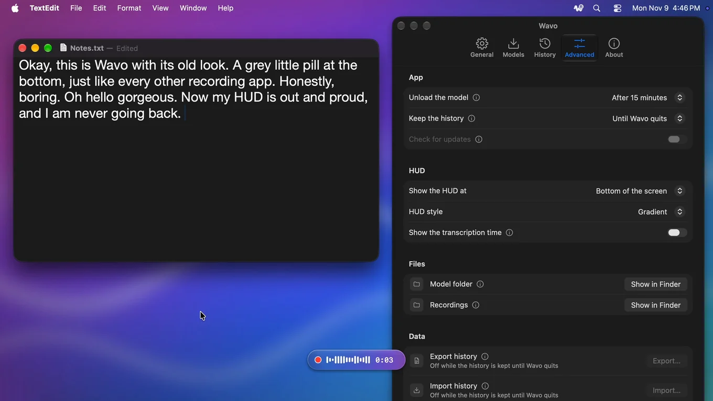
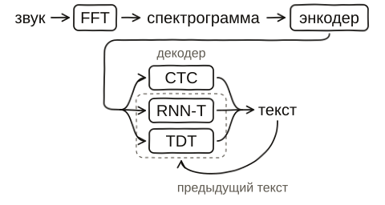
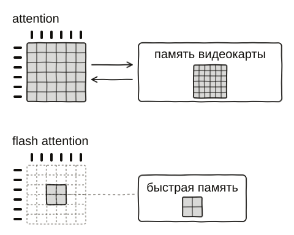

Поменял MacBook M2 в старом корпусе на новый Air M5 без вентилятора. При переходе на новый компьютер хочется нового и чистого. Поэтому вместо того, чтобы тащить за собой все старые программы и настройки, решил поискать альтернативы полегче и нативнее. Например, VS Code заменил на [Zed](https://github.com/zed-industries/zed), Chrome — на [Helium](https://github.com/imputnet/helium).

Для работы с агентами пользовался программой для диктовки [Handy](https://github.com/cjpais/Handy), но мне жутко не нравилось, что она написана на [Tauri](https://github.com/tauri-apps/tauri), хотелось чего-то нативного. Попросил агента найти альтернативу. Но ничего из того, что он нашёл, мне не подходило. Решил написать сам.

Вдохновившись X, где люди сейчас переписывают всё на [GPUI Kit](https://github.com/longbridge/gpui-kit), решил попробовать тоже. Тем более автор Handy выделил движок распознавания речи отдельно в [transcribe.cpp](https://github.com/handy-computer/transcribe.cpp), поэтому оценил задачу как лёгкую, тем более с помощью агентов.

## Неделя 1. Выбор GUI и прототипы

Собственно, взял GPUI Kit, распиаренный в X, и с агентами быстро сделал первую версию интерфейса. Получилось неплохо, приложение с открытым окном занимало около 80 МБ оперативной памяти. Но компиляция была жутко долгой, частично из-за самого GPUI Kit, частично из-за линковки transcribe.cpp, которая шла около минуты при каждой пересборке.

Ещё не понравилось, что GPUI Kit тащит с собой больше 400 зависимостей, прямо как в Node.js. Кто знает, какой вирус может оказаться внутри? Кроме того, [GPUI](https://github.com/zed-industries/zed/tree/main/crates/gpui) от Zed не является готовой библиотекой со стабильными релизами, поэтому GPUI Kit сидит на dev-версии из репозитория Zed, и API может поменяться в любой момент. Отдельная проблема — интеграция с системой, вроде иконки в трее или нативного контекстного меню. В GPUI Kit этого нет, и всё это нужно писать самому.

Решил посмотреть, какие есть альтернативы в Rust-инфраструктуре. Помню, что ещё в доагентскую эпоху экспериментировал с [egui](https://github.com/emilk/egui) для интерфейсов, и от него остались хорошие впечатления. Он и правда оказался быстрее и легче по памяти, да и крейтов тянул меньше. Но все нативные интеграции всё равно нужно писать самому, а компоненты сильно кастомизировать, чтобы они выглядели приятно.

Отдельно попробовал нативные контролы: Rust-биндинги к системным UI-библиотекам — AppKit на macOS, Win32 на Windows и GTK на Linux. Тоже вдохновился проектом из X — [mygo](https://github.com/egoist/mygo): в нём нативные десктопные интерфейсы делают на Go. Но по сути пришлось писать гигантскую кучу кода интеграции и повторять это минимум три раза. Вид приложения получался нативным под каждую платформу, но настолько разным, что некоторые фичи нельзя было нормально выразить, несмотря на то, что программа для диктовки — это буквально меню настроек, список моделей и история.

Всё это время больше всего раздражала пересборка: при каждом запуске приходилось ждать под минуту, пока линкуется transcribe.cpp. Ну и вообще непонятно, почему в моём Rust-тулчейне должен быть C++. Решил посмотреть, что там внутри происходит.

## Неделя 2. Свой движок распознавания речи

Внутри transcribe.cpp оказался [ggml](https://github.com/ggml-org/ggml), где под каждую видеокарту написан свой код для Metal, Vulkan и CUDA, и для сборки каждого нужны свои инструменты. В Rust есть [wgpu](https://github.com/gfx-rs/wgpu), где шейдеры пишутся один раз на [WGSL](https://www.w3.org/TR/WGSL/) и работают на любой видеокарте, а всё собирается обычным `cargo build`.

Стало любопытно, получится ли запустить на WGSL хотя бы одну модель, хотя мыслей что-то переписывать ещё не было. Взял [GigaAM](https://github.com/salute-developers/GigaAM) v3, которой пользуюсь чаще всего, и сделал на ней небольшое демо. На удивление, агенту легко удалось писать шейдерный код, и результаты получились сравнимые с оригинальной библиотекой.

Тут появился спортивный интерес. Вспомнил, как занимался оптимизацией быстрого счёта на кривой secp256k1 в [ecloop](https://github.com/vladkens/ecloop) и [оптимизацией RIPEMD-160](/rmd160-simd/), и начал смотреть дальше. Первой была GigaAM v3 e2e RNN-T, модель с пунктуацией и заглавными буквами. Кроме неё решил добавить и другие модели того же семейства, чтобы понять, насколько это сложно. Они отличаются декодером: CTC распознаёт каждый кусочек звука отдельно, а RNN-T учитывает ещё и свой предыдущий текст, поэтому точнее, но медленнее. И у каждой есть версия с пунктуацией (e2e) и без неё.

Для диктовки использую два языка: русский и английский. И раз первый вышло добавить легко, подумал, что со вторым тоже не должно возникнуть проблем. Для английского хорошо подходит [Parakeet v2](https://huggingface.co/nvidia/parakeet-tdt-0.6b-v2) от NVIDIA, она точная и быстрая. Но когда начал её добавлять, оказалось, что модели бывают разных архитектур и для каждой нужно писать свой код вычислений.

Сами модели брал уже упакованными в GGUF от автора transcribe.cpp. Как оказалось, GGUF хранит только веса и метаинформацию о модели: название архитектуры, размеры слоёв, словарь. Самих вычислений в файле нет, и их нужно писать самому. Этим формат и отличается от TensorFlow или Core ML от Apple, где в файле модели описан граф операций, а среда просто его исполняет.

В общем, пришлось сидеть и разбираться, читать, смотреть видео на YouTube о том, как устроены и работают модели распознавания речи. Если коротко, длинное аудио режется на куски (у Whisper, например, это окна по 30 секунд). Каждый кусок через быстрое преобразование Фурье (FFT) превращается в спектрограмму (какие частоты звучат в каждый момент). Спектрограмму получает энкодер (стопка слоёв нейросети, в которых в основном перемножаются матрицы) и превращает её в последовательность векторов. Декодер читает их и шаг за шагом выдаёт токены (кусочки слов), из которых собирается текст. Основная работа — матричные умножения в слоях энкодера, их и считает видеокарта.



Разобравшись с тем, как это работает, добавил поддержку Parakeet v2. Первую версию за ночь написал Codex, но вышло грязно, так что выкинул её и переписал начисто с Claude Code. В итоге получилась довольно быстрая программа speech-to-text, которая на моих тестах обгоняла transcribe.cpp. И раз уж вошёл в раж, сразу добавил [Parakeet v3](https://huggingface.co/nvidia/parakeet-tdt-0.6b-v3), мультиязычную модель из того же семейства (почти ничего не пришлось дописывать). А следом и [Whisper](https://github.com/openai/whisper) как эталонную модель, с которой удобно сравнивать остальные.

Отличий у Parakeet от GigaAM хватает. Модель крупнее (24 слоя против 16, и каждый шире), ужимает звук вдвое сильнее (один вектор на 80 мс вместо 40) и иначе отмечает, в какой момент что прозвучало. Но главное в декодере (TDT): вместе с очередным токеном он предсказывает, сколько следующих отрезков звука можно пропустить.

И раз программа в целом так хорошо получалась, решил выложить её отдельным проектом в стиле [ollama](https://github.com/ollama/ollama). Назвал её [wavo](https://github.com/vladkens/wavo), типа от WAV, и имя было свободное. Тем более что раньше уже бывала нужда в локальной расшифровке аудио, а ничего хорошего из терминала для этой задачи не было. Пробовал [whisper.cpp](https://github.com/ggml-org/whisper.cpp), но это медленно и неудобно (его нужно компилировать самому, а аудио резать на куски вручную).

Перед публикацией решил причесать код. Сборку всё ещё тормозил крейт [rustfft](https://github.com/ejmahler/RustFFT), а раз wavo могут подключать как библиотеку, эта задержка досталась бы каждому, кто его собирает. Поэтому, разобравшись с причиной, написал свой FFT под конкретную задачу. Вышло 176 строк кода против 55 тысяч в rustfft, а пересборка ускорилась с 11,9 до 2,1 секунды (сам крейт хороший, просто рассчитан на все случаи, а нужен был один).

Финальный этап перед публикацией — тестирование. Хорошо, что под рукой несколько маков, Linux на N100 и x86 с видеокартой GeForce и хорошим процессором. Поручил агенту прогнать финальные тесты и сравнить скорость с другими библиотеками. На маках моя библиотека рвала всех по скорости без вопросов (до сих пор в шоке, что это так легко получилось). Но на Windows с видеокартой NVIDIA был большой провал. Снова пришлось разбираться, и оказалось, что есть такая штука, как flash attention.

Attention — это место в модели, где каждый вектор сравнивается со всеми остальными в том же куске аудио (у Whisper это 1500 векторов на 30 секунд, то есть больше двух миллионов сравнений в каждом слое). Обычный код записывает всю эту таблицу в память видеокарты и потом читает обратно. Flash attention считает то же самое небольшими порциями в быстрой памяти рядом с ядрами видеокарты и таблицу целиком не хранит.



На маках агент сделал такие шейдеры ещё раньше, но под матричные блоки Apple (аппаратное ускорение). У NVIDIA эти блоки другого размера, поэтому там wavo считал всё стандартным кодом. После добавления шейдеров под матричные блоки NVIDIA wavo на Windows догнал, а где-то и перегнал transcribe.cpp (короткую запись Whisper turbo теперь распознаёт за 201 мс против 226 у конкурента, а было 637).

Все замеры делал на RTX 4060, а на AMD Radeon не тестировал вовсе. Поэтому буду рад результатам с других видеокарт в [issues](https://github.com/vladkens/wavo/issues).

Ещё во время тестов нашёл, что на M5 wgpu использует только старые матричные блоки. В M5 в каждом ядре видеокарты появился [нейроускоритель](https://www.apple.com/newsroom/2025/10/apple-unleashes-m5-the-next-big-leap-in-ai-performance-for-apple-silicon/), который умножает матрицы втрое быстрее (0,60 мс против 1,89 мс). Но добраться до него можно только через Metal 4, а wgpu его пока не знает. Обошёл это отдельным шейдером на Metal только для M5 и завёл [issue в wgpu](https://github.com/gfx-rs/wgpu/issues/10626).

Ещё научил wavo работать на Neural Engine (отдельной части чипов Apple для нейросетей), но это уже другая история. В общем, в конце провёл финальное сравнение Parakeet v3 на английском против других движков, и цифры получились впечатляющими.

| Движок         | На чём        | Фраза 5 с | Час записи |
| -------------- | ------------- | --------: | ---------: |
| wavo           | Neural Engine |    0,12 с |       200× |
| FluidAudio     | Neural Engine |    0,13 с |       175× |
| wavo           | GPU           |    0,14 с |       160× |
| transcribe.cpp | GPU           |    0,12 с |       107× |
| parakeet.cpp   | GPU           |    0,77 с |        90× |
| parakeet-mlx   | GPU           |    0,63 с |        61× |
| sherpa-onnx    | CPU           |    0,83 с |        39× |

В таблице время на фразу в 5 секунд и во сколько раз быстрее реального времени распознаётся часовая запись (MacBook Pro на M5). На русском с GigaAM v3 разрыв похожий (wavo в 330 раз быстрее реального времени, transcribe.cpp в 262).

## Неделя 3. Свой рендер

Пока шла работа над wavo, другой агент в фоне экспериментировал с библиотекой интерфейса. Раз во всех подходах всё равно приходилось руками писать много обёрток для связи с операционной системой, решил, что можно написать и рендер самому. К тому же был опыт с интерфейсами в видеоиграх, так что задача казалась несложной.

Давно являюсь поклонником [Sublime Text](https://www.sublimetext.com) и особенно [Sublime Merge](https://www.sublimemerge.com) и их подхода к интерфейсу. Подумал, раз авторы этих программ и авторы редактора Zed смогли написать свой UI-фреймворк, то и я, вооружившись агентом, смогу. Вооружившись утилитами `strings` и `nm`, посмотрели, какие системные функции использует Sublime Merge, и по ним восстановили идею, она была интересной ;)

Текст там рисует сама система (CoreText на macOS, DirectWrite на Windows, Pango на Linux), поэтому он везде выглядит нативно, в отличие, например, от egui, который рисует глифы своими средствами. Каждый глиф система рисует один раз, он кладётся в кэш, и дальше на экран идут уже готовые глифы из кэша. Так же, системными, сделаны и контекстные меню (в GPUI Kit их по умолчанию рисуют сами).

В общем, получился такой себе Франкенштейн — по краям системные вещи, а в центре, как начинка в сэндвиче, моя библиотека, которая раскладывает элементы по окну и собирает из них компоненты.

Для рендеринга используется immediate mode (кадр каждый раз собирается заново, без сложной системы событий). В обычных приложениях не так много интерактивности, и условное окно настроек не нужно перерисовывать 60/120 раз в секунду. К тому же кадр пересобирается, только когда что-то изменилось, а в простое окно ничего не рисует.

Рисовать сам кадр решил на CPU. Это самый простой код, и работает он везде одинаково — без шейдеров, драйверов и прочей лабуды, которую нужно интегрировать, а потом ещё и тестировать. Готовый кадр отдаётся системе в обычный 2D-вывод окна, и для приложения без сложных анимаций скорости хватает с запасом.

3D-ускорение тянет за собой дополнительные библиотеки, и программа начинает есть больше памяти (на Windows простое окно с D3D11 занимает 27 МБ вместо 5,1). Но если понадобится, его всегда можно добавить потом.

Сам рендер получился где-то в 3 тысячи строк кода на Rust, и агент быстро накидал на нём базовые компоненты (ещё около 6 тысяч строк). Всё работало, и казалось, что дело почти сделано.

Дальше понадобились контекстное меню и всплывающее окошко, в котором видно, что диктуешь. И тут начались боль и страдания, особенно когда запустил всё не в виртуалках, а на настоящих компьютерах с Linux и Windows.

Теперь стало понятно, почему в доагентскую эпоху было так мало GUI-фреймворков. Сложность совсем не в том, чтобы написать рендер и систему компонентов, а в том, чтобы связать всё это на разных платформах и чтобы оно работало. Каждая кроссплатформенная фича легко может занимать несколько тысяч строк на три системы:

- окна (открыть, перетаскивать и рисовать в них): 5 тысяч строк;
- текстовые поля и IME: 4 тысячи;
- трей, горячие клавиши и автозапуск: 7 тысяч;
- доступность на macOS: 3 тысячи;
- нативное контекстное меню: 2 тысячи.

Код, конечно, пишет агент, но его всё равно нужно читать, проверять и тестировать на каждой системе, а это много работы.

Например, контекстное меню можно нарисовать и своим рендером, так сделано в GPUI в Zed. Но смотрится это стрёмно, а главное, такое меню не может выйти за рамки окна. Раньше даже не задумывался об этом, но, начав писать, понял, что это важно. Sublime Merge это умеет, за что его и хвалю.

Ожидаемо, самой большой болью оказался Linux. Если на macOS и Windows всё делается через один системный API, то на Linux это грёбаный зоопарк. Сначала пытался отдельно рисовать на X11 и Wayland, чтобы программа была максимально оптимизирована, но количество кода росло по экспоненте. Поэтому пошёл на компромисс и взял GTK 3, который есть почти на всех дистрибутивах, так же сделано и в Sublime Merge.

Библиотеку назвал [nimbo](https://github.com/vladkens/nimbo). Простое [окно со счётчиком](https://github.com/vladkens/nimbo/blob/main/examples/counter.rs) на ней тянет 14 крейтов на macOS, 5 на Windows и 3 на Linux (почти всё это биндинги к системе, вроде objc2 на macOS и windows-sys на Windows), собирается с нуля за 11 секунд, а бинарник весит 1,3 МБ. Для сравнения тот же счётчик на других фреймворках (число крейтов на каждой системе, чистая релизная сборка на M2 и размер бинарника):

|          | macOS | Windows | Linux | Сборка | Бинарник |
| -------- | ----: | ------: | ----: | -----: | -------: |
| nimbo    |    14 |       5 |     3 |   11 с |   1,3 МБ |
| iced     |   152 |     159 |   237 |   59 с |  10,9 МБ |
| Tauri¹   |   217 |     223 |   265 |   64 с |   9,9 МБ |
| Xilem    |   157 |     177 |   257 |   65 с |  12,2 МБ |
| egui     |   177 |     178 |   279 |   74 с |  14,3 МБ |
| Slint    |   248 |     244 |   345 |   84 с |  12,5 МБ |
| GPUI     |   300 |     270 |   322 |   86 с |   8,6 МБ |
| GPUI Kit |   411 |     395 |   518 |  144 с |  19,4 МБ |

¹ Плюс системный WebView, который в бинарник не входит.

В эпоху персонального софта и бесконечных взломов для такого рода программ хотелось бы иметь свою основу и не зависеть от чужих фреймворков. Поэтому решил довести nimbo до ума. Первого релиза пока нет, сейчас доделываю API, поэтому не хватает времени делать крутые видео в X. Но если кому-то нужно что-то минимальное на Rust, велком.

Библиотеку строю в три слоя. Снизу общий API для системных вещей (окна, трей, контекстное меню и тому подобное), чтобы из кода приложения не касаться их в принципе. Над ним headless-компоненты (поведение без оформления), под которые можно сделать любой дизайн. И сверху базовый дизайн в стиле системных контролов. Ориентир для API библиотеки — SwiftUI.

## Неделя 4. Релиз: подпись, упаковка, обновления

Программа готова и протестирована, осталось только выпустить релиз. Но и тут всё оказалось не так просто. Проблем набралось три: подпись, упаковка и автообновление, и на них ушла последняя неделя.

### Подпись

В последних версиях macOS и Windows приложения без подписи просто не запускаются. На Windows проще: SmartScreen при первом запуске покажет предупреждение, с ним можно согласиться, и приложение запустится. А на macOS с неподписанного приложения нужно руками снимать карантин командой `/usr/bin/xattr -dr com.apple.quarantine /Applications/Wavo.app`, что рядовой пользователь вряд ли будет делать.

Пришлось раскошелиться на 99 долларов в год и заплатить Apple. Форма оплаты у них при этом из начала нулевых: данные карты вводишь руками, а деньги Apple списывает сама когда-нибудь потом. Списание в итоге упало на 3-D Secure, пришлось временно понижать защиту на карте и писать в поддержку, чтобы повторили оплату, и вся история растянулась на несколько дней. Такого давно уже не припомню.

### Упаковка

Программа для трёх систем — значит, и установщики нужны на все три: на macOS стандартное решение — DMG, на Windows — `setup.exe`, который ставит программу, обычно на NSIS, а на Linux — AppImage и .deb-пакет. Форматов на Linux на самом деле больше, но пока выбрал эти два.

Сначала показалось, что это легко сделать Python-скриптом, что и поручил агенту. Требование было одно: сборка и подпись разделены. У этапа сборки, который скачивает и компилирует чужой код, доступа к ключам подписи быть не должно, а второй этап только ставит подпись на готовые файлы.

Скрипт быстро вырос почти до двух тысяч строк. Тут я удивился и пошёл искать готовые решения, ведь за столько лет кто-то наверняка решил эту задачу. Некоторые решения нашлись ([Velopack](https://github.com/velopack/velopack), [cargo-packager](https://github.com/crabnebula-dev/cargo-packager) и упаковщик Tauri), но у всех свои проблемы. Одни не умеют отделять сборку от подписи, а самое неприятное, что почти никто не умеет работать на одной машине (DMG и подпись для macOS делают только на Mac, deb и AppImage только на Linux, а для Windows нужен ещё NSIS). Velopack умеет собрать всё сразу, но только на Mac. По-моему, это безумие, упаковка и подпись должны работать на одном компьютере, причём желательно на любом.

Поизучал чужие репозитории, и из того, что видел, нормально это сделано только у Mozilla. Firefox они упаковывают на Linux, даже DMG для macOS, но лютыми хаками. Для DMG у них свой форк C-библиотеки [libdmg-hfsplus](https://github.com/mozilla/libdmg-hfsplus), у которого нет готовых сборок, и в CI его собирают прямо из репозитория по коммиту. Чтобы использовать его у себя, пришлось бы вытаскивать артефакт из чужого билда без версии, а этого не хотелось. Ну и раз есть агент, то снова поручил эту работу ему.

Изначально хотел сделать это частью nimbo, но потом понял, что это совершенно отдельная программа, и вынес её в отдельный крейт [shipo](https://github.com/vladkens/shipo).

Главная идея shipo в том, что все установщики собираются на любой машине, хоть на Linux. Всё, что есть только на одной системе (hdiutil на macOS, makensis для Windows, пакеты apt на Linux), заменено своим кодом, а остальные утилиты скачиваются с фиксированной версией и хешем.

Для macOS shipo сам пишет DMG вместе с файловой системой HFS+ по спецификации Apple (даже с таблицами Unicode, по которым HFS+ нормализует имена файлов) и `.DS_Store`, который раскладывает в окне иконку приложения и ярлык на /Applications. Иконку `.icns` он тоже собирает сам, без `sips` и `iconutil`. Подпись и нотаризация вне Mac идут через rcodesign и сервис нотаризации Apple.

Для Windows установщик тоже свой. Это заранее собранный маленький `setup.exe` на Rust с пустой меткой внутри. Упаковщик подменяет в exe приложения иконку, версию и манифест, сжимает файлы в один архив, дописывает его в конец `setup.exe` и прописывает в метку, где этот архив лежит. Деинсталлятор — это тот же `setup.exe`, только без файлов.

Для Linux AppImage (готовый рантайм, к которому дописан образ squashfs с приложением) и deb собираются прямо в памяти.

### Автообновление

Третья вещь к упаковке по факту отношения не имеет, но заниматься пришлось и ей. На macOS многие программы обновляются через [Sparkle](https://sparkle-project.org), но он работает только на macOS. Под Windows есть похожий по идее [WinSparkle](https://github.com/vslavik/winsparkle), но это другая библиотека. Хотелось чего-то одного для всех систем, но и тут ничего не нашёл. Решил, что сборка и обновление — близкие вещи и могут жить в одном крейте, поэтому сделал их вместе.

Идея автообновления простая. Вместе с релизом публикуется небольшой файл с описанием последней версии. Приложение время от времени его читает и, если версия новее, само скачивает и ставит обновление.

У shipo это один текстовый файл `update.txt` в последнем релизе на GitHub:

```text
version 1.2.0
notes https://github.com/me/hello/releases/tag/v1.2.0
macos-aarch64 394788 <sha512> https://github.com/me/hello/releases/download/v1.2.0/Hello-v1.2.0-macos-aarch64.dmg
windows-x86_64 285930 <sha512> https://github.com/me/hello/releases/download/v1.2.0/Hello-v1.2.0-windows-x64-setup.exe
linux-x86_64 412204 <sha512> https://github.com/me/hello/releases/download/v1.2.0/Hello-v1.2.0-linux-x86_64.AppImage
sig <signature>
```

В нём версия, ссылка на заметки к релизу, по строке на каждую платформу (размер, хеш SHA-512 и адрес файла) и в конце подпись Ed25519 всего, что выше. Отдельный сервер обновлений не нужен, приложение просто качает файл из последнего релиза на GitHub по постоянной ссылке (`releases/latest/download/update.txt`).

Приложение сверяет скачанный файл по размеру и хешу. Ключей подписи в приложении два, рабочий и запасной: если рабочий утечёт, следующий релиз подписывается запасным.

Для обновления используется тот же установщик, что и для первой установки. На macOS библиотека подключает DMG, копирует из него приложение и заменяет старое. На Windows запускает `setup.exe` без окна, на Linux заменяет файл AppImage.

Для HTTP в shipo нет отдельной библиотеки, вместо неё три короткие обёртки над системными (NSURLSession на macOS, WinHTTP на Windows, libcurl на Linux). Поэтому зависимостей у апдейтера мало: проверка подписи, ошибки и биндинги к системе.

Так за неделю появился shipo, около 12 тысяч строк кода: примерно 10 тысяч на упаковщик (вместе с заготовкой `setup.exe`) и 2,4 тысячи на библиотеку, которая попадает в приложение. Упаковщик в нём собирает установщики для всех трёх систем на одной машине, а апдейтер добавляет в приложение всего 8–15 крейтов в зависимости от системы (у Velopack и cargo-packager их больше сотни). По итогу правильно зарелизить приложение и настроить CI оказалось сложнее, чем написать рендер интерфейса.

## Итого

Программа на пару дней превратилась в месяц работы. За это время набралось около 850 коммитов и 167 тысяч строк изменений (вместе с прототипами и тем, что потом выкинул). Работа с агентами заняла около 90 активных часов и 3,7 млрд токенов, по ценам API это примерно 2,7 тысячи долларов (цифры примерные, часть логов агентов потерялась).

Код в основном писал [Claude Opus 5.5](https://www.anthropic.com/claude/opus), ревью делала [GPT-6 Astra](https://openai.com/index/gpt-6-astra/). Ещё около 390 ревью сделал Copilot в GitHub, пока я не словил лимит. Графику и картинки рисовал Codex.

На этом работа не закончилась. Чтобы о программе узнал кто-то, кроме родственников и друзей, про неё нужно написать на Reddit, в X и прочих местах, и это тоже отдельная большая работа. Пока ей занимался, нашёл множество похожих программ, и, если бы видел их изначально, наверняка бы не занимался своей программой в принципе. Но что уже есть, то есть. В принципе, вышел свой кросс-платформенный стек, который, надеюсь, буду переиспользовать для других вещей.

Ещё раз все программы из статьи:

- [Wavo](https://github.com/vladkens/wavo-app): локальная диктовка для macOS, Windows и Linux;
- [wavo](https://github.com/vladkens/wavo): CLI и Rust-крейт для распознавания речи в стиле ollama;
- [nimbo](https://github.com/vladkens/nimbo): нативная UI-библиотека почти без зависимостей;
- [shipo](https://github.com/vladkens/shipo): установщики и автообновление для трёх систем с одной машины.

Хотел сделать одну маленькую программу для диктовки, а вышла программа и три библиотеки к ней.
